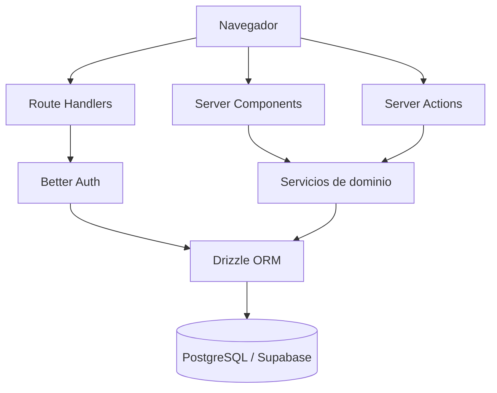

# Arquitectura — Planify

Planify será un **monolito modular** en Next.js: la misma aplicación sirve la UI (App Router / Server Components) y el backend (Server Actions y unos pocos Route Handlers). Hoy el repositorio solo contiene el scaffold; el diseño objetivo está en `PLANIFY.md`.

## Estado del código vs. diseño

| Hoy en el repo | Previsto (`PLANIFY.md`) |
|---|---|
| `app/page.tsx` y `app/layout.tsx` (plantilla) | Módulos: identidad, proyectos, planificación, trazabilidad, preparación, colaboración |
| Sin base de datos | PostgreSQL administrado por Supabase, accedido con Drizzle **solo en servidor** |
| Sin auth | Better Auth (correo/contraseña); no mezclar con Supabase Auth |

## Componentes principales (objetivo)

- **UI (App Router):** lecturas en Server Components; mutaciones de interfaz en Server Actions que delegan en servicios.
- **Servicios de dominio:** transacciones y reglas (invitaciones, transferencia, aprobación, purga, cobertura de trazabilidad). No viven en JSX.
- **Persistencia:** Drizzle + PostgreSQL. Restricciones SQL (FK compuestas, únicos) son la última barrera de integridad.
- **Identidad:** esquema generado por Better Auth (`user`, `session`, `account`, `verification`). FKs de Planify a usuarios: `TEXT`.
- **Trazabilidad:** `planning_items` (`objective` / `requirement` / `user_story` / `task`) + `traceability_links`.

## Diagrama

## Flujo de datos (previsto)

1. Lectura: Server Component → servicio/consulta Drizzle → HTML.
2. Mutación de UI: Server Action valida Zod + sesión/rol → servicio transaccional → PostgreSQL.
3. Auth HTTP: Route Handler de Better Auth. No hay API REST interna para el flujo del MVP.
4. Cadena de trazabilidad: `Objetivo → Requisito → Historia → Tarea`. Las relaciones las crea el usuario.

## Decisiones de diseño clave

- **Un solo runtime TypeScript** en lugar de Laravel + Vue + Inertia + MySQL.
- **Drizzle** para restricciones e índices explícitos; las relaciones del ORM no sustituyen las de PostgreSQL.
- **Supabase = Postgres**, no Data API ni Auth de producto.
- **`projects.owner_id` canónico**; el rol `owner` en `project_members` se sincroniza en la misma transacción.
- **Sin** microservicios, Redis, base de grafos, API pública ni IA en el MVP.

## Restricciones y trade-offs

- RLS en tablas públicas de Supabase aunque la app no use el Data API desde el navegador.
- Operaciones críticas (invitar, transferir, aprobar, purgar) siempre en transacción PostgreSQL.
- Credenciales de Postgres / `service_role` nunca en el cliente.

Detalle de esquema, invitaciones y preparación: `PLANIFY.md` §§10–11, 24–33.
