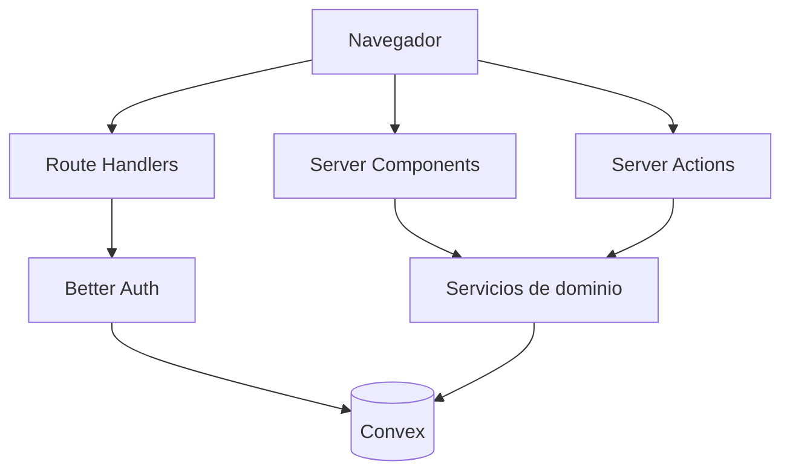

# Arquitectura — Planify

Planify será un **monolito modular** en Next.js: la misma aplicación sirve la UI (App Router / Server Components) y el backend (Server Actions y unos pocos Route Handlers). Hoy el repositorio cubre la Fase 0 (backend Convex e identidad cableados); el diseño objetivo está en `PLANIFY.md`.

## Estado del código vs. diseño

| Hoy en el repo | Previsto (`PLANIFY.md`) |
|---|---|
| `app/page.tsx` y `app/layout.tsx` mínimos | Módulos: identidad, proyectos, planificación, trazabilidad, preparación, colaboración |
| Convex desplegado con las tablas de identidad de Better Auth; sin módulos de dominio | Módulos de dominio sobre el mismo backend |
| Better Auth cableado (correo/contraseña) vía `@convex-dev/better-auth` | Igual, con verificación y recuperación de contraseña completas |

## Componentes principales (objetivo)

- **UI (App Router):** lecturas en Server Components; mutaciones de interfaz en Server Actions que delegan en servicios.
- **Servicios de dominio:** transacciones y reglas (invitaciones, transferencia, aprobación, purga, cobertura de trazabilidad). No viven en JSX.
- **Persistencia:** la base de datos integrada de Convex; los validadores del esquema y las comprobaciones dentro de las mutaciones atómicas son la barrera de integridad.
- **Identidad:** esquema generado por Better Auth en Convex (`user`, `session`, `account`, `verification`). Las FK a usuarios son cadenas (`v.string()`).
- **Trazabilidad:** `planning_items` (`objective` / `requirement` / `user_story` / `task`) + `traceability_links`.

## Diagrama

## Flujo de datos (previsto)

1. Lectura: Server Component o hook de cliente → función de consulta de Convex → HTML.
2. Mutación de UI: Server Action valida Zod + sesión/rol → servicio → mutación de Convex (transacción atómica).
3. Auth HTTP: Route Handler de Next.js que proxia Better Auth hacia el deployment de Convex. No hay API REST interna para el flujo del MVP.
4. Cadena de trazabilidad: `Objetivo → Requisito → Historia → Tarea`. Las relaciones las crea el usuario.

## Decisiones de diseño clave

- **Un solo runtime TypeScript** en lugar de Laravel + Vue + Inertia + MySQL.
- **Esquema nativo de Convex** con validadores e índices declarados; los tipos fluyen de la base de datos al navegador sin ORM.
- **Convex** como backend con base de datos propia; la identidad sigue siendo Better Auth, no la auth nativa de Convex.
- **`projects.owner_id` canónico**; el rol `owner` en `project_members` se sincroniza en la misma transacción.
- **Sin** microservicios, Redis, base de grafos, API pública ni IA en el MVP.

## Restricciones y trade-offs

- Acceso restringido por sesión y rol en las funciones de Convex aunque el navegador no llame directamente al backend.
- Operaciones críticas (invitar, transferir, aprobar, purgar) siempre dentro de una mutación de Convex (transacción).
- Secretos (`BETTER_AUTH_SECRET`, etc.) nunca en el cliente; solo viajan variables `NEXT_PUBLIC_*`.

Detalle de esquema, invitaciones y preparación: `PLANIFY.md` §§10–11, 24–33.
